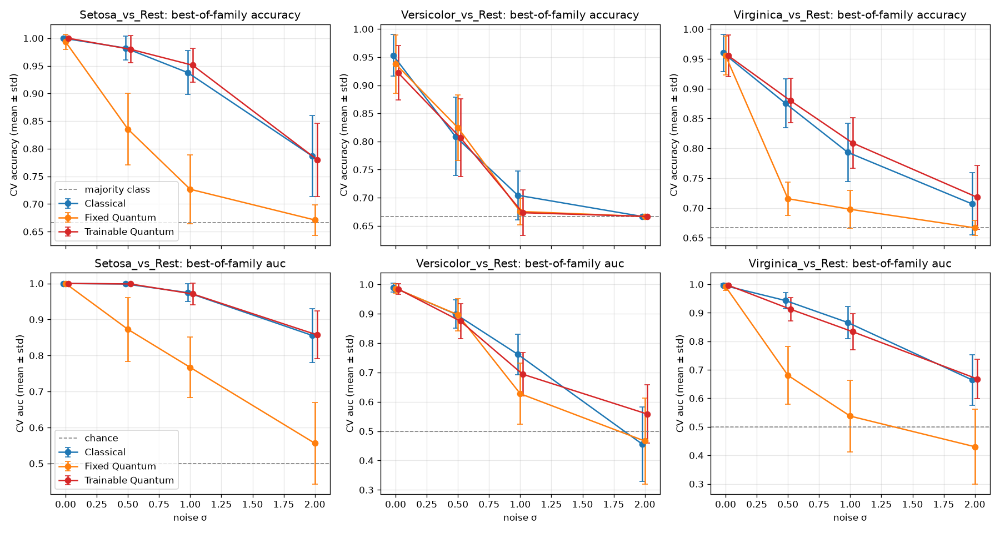

# Quantum Kernel SVM

Classical vs quantum-kernel support vector machines on the Iris dataset, compared with leak-free
repeated cross-validation, plus a controlled feature-noise sweep with corrected paired statistical tests.

Built with Qiskit 2.6, Qiskit Machine Learning 0.9 and scikit-learn 1.9.

## Key findings

- **Noise-free, there is no quantum advantage.** On all three problems, the best classical, fixed quantum
  and trainable quantum kernels are within 0.04 accuracy of each other. None of the differences are
  statistically significant.
- **Fixed quantum kernels break first.** At σ = 0.5, the best fixed quantum kernel loses to the best
  classical kernel on all 15 folds for Setosa (−0.147, p = 0.001) and Virginica (−0.160, p < 0.001).
- **Trainable quantum kernels track classical ones at every noise level.** No difference is significant
  (p ≥ 0.196 everywhere).
- **Versicolor-vs-rest is the hardest problem.** All families fall together and sit exactly at the
  majority-class baseline (0.667) at σ = 2.

Best-of-family CV accuracy (mean over 5 folds × 3 repeats; the majority-class baseline is 0.667):

| Problem    | Family            | σ = 0 | σ = 0.5 | σ = 1 | σ = 2 |
|------------|-------------------|-------|---------|-------|-------|
| Setosa     | Classical         | 1.000 | 0.982   | 0.938 | 0.787 |
|            | Fixed quantum     | 0.993 | 0.836   | 0.727 | 0.671 |
|            | Trainable quantum | 1.000 | 0.980   | 0.951 | 0.780 |
| Versicolor | Classical         | 0.953 | 0.809   | 0.704 | 0.667 |
|            | Fixed quantum     | 0.938 | 0.824   | 0.676 | 0.667 |
|            | Trainable quantum | 0.922 | 0.807   | 0.673 | 0.667 |
| Virginica  | Classical         | 0.960 | 0.876   | 0.793 | 0.707 |
|            | Fixed quantum     | 0.956 | 0.716   | 0.698 | 0.667 |
|            | Trainable quantum | 0.956 | 0.880   | 0.809 | 0.718 |



## Method

- **Data.** Iris (150 samples, 4 features), split into three one-vs-rest problems (50 vs 100 samples
  each).
- **Per-fold pipeline.** Every model goes through the same steps:
  1. `SelectKBest(f_classif, k=2)` and `MinMaxScaler((0, π))` are fitted on the training fold only.
  2. The kernel is fitted on the training fold; this is where trainable kernels are optimised.
  3. `K_train` and `K_test` are each computed once.
  4. `SVC(kernel="precomputed")` is trained. Predictions and AUC both come from the same decision
     scores.
- **Models (12).**
  - Classical: RBF, polynomial (degree 3) and linear.
  - Fixed quantum: `zz_feature_map`, `z_feature_map` and `pauli_feature_map(["Y", "ZZ"])`, all
    evaluated with `FidelityStatevectorKernel`.
  - Trainable quantum: three parameterised feature maps, each trained with SPSA and with COBYLA through
    `QuantumKernelTrainer`.
  - All quantum kernels are exact statevector simulations (no shot noise).
- **Cross-validation.** `RepeatedStratifiedKFold(5 splits × 3 repeats, seed 42)`. Every model and
  problem shares the same 15 folds, so comparisons can be paired fold by fold.
- **Noise.** Gaussian noise N(0, σ²) is added to the raw features before the pipeline runs. With a
  fixed seed, every σ level uses the same random draw scaled by σ, so differences between levels come
  from σ alone.
- **Statistics.** Quantum and classical models are compared with the Nadeau–Bengio corrected resampled
  t-test, together with win/tie/loss counts per fold. A plain paired t-test would overstate
  significance, because CV folds share training data.

## Quickstart

Requires Python ≥ 3.12 and [uv](https://docs.astral.sh/uv/).

```bash
uv sync
uv run python src/QSVC.py --noise 0 0.5 1 2   # full sweep, ~11-13 min per noise level
uv run python src/compare_noise.py            # degradation table, paired tests, plot
uv run python tests/test_qsvc.py              # leakage, reproducibility and t-test checks
```

`QSVC.py` options:

| Option      | Default   | Meaning                                                   |
|-------------|-----------|-----------------------------------------------------------|
| `--noise`   | `0`       | One or more noise σ values; several values run a sweep    |
| `--splits`  | `5`       | CV folds                                                  |
| `--repeats` | `3`       | CV repetitions                                            |
| `--maxiter` | `50`      | Optimizer iterations for trainable kernels                |
| `--seed`    | `42`      | Seed for the folds, the noise and the optimizers          |
| `--jobs`    | `-1`      | Parallel workers (`1` gives clean timings)                |
| `--out`     | `results` | Output directory                                          |

## Outputs (`results/`)

| File                         | Content                                                      |
|------------------------------|--------------------------------------------------------------|
| `folds_noise<σ>.csv`         | Every metric for every problem, model and fold (540 rows)    |
| `summary_noise<σ>.csv`       | Mean and std over folds for each problem and model           |
| `comparison_noise<σ>.png`    | Per-problem accuracy bars, plus accuracy vs fit time         |
| `noise_degradation.csv`      | Best-of-family and family-mean accuracy/AUC per σ            |
| `noise_paired.csv`           | Best quantum vs best classical, paired per fold, with t-test |
| `noise_degradation.png`      | Accuracy and AUC vs σ per family, with chance levels         |

## Project layout

```
src/QSVC.py            models, leak-free CV, per-noise-level outputs
src/compare_noise.py   noise-sweep degradation and paired statistical comparison
tests/test_qsvc.py     self-checks (runs standalone or under pytest)
results/               outputs of the sweep above
```

## Limitations

- **Best-of-family is optimistic.** The best model in each family is picked on the same CV scores it
  is reported with, which inflates its score. `noise_degradation.csv` also reports family means.
- **No hyperparameter tuning.** `C = 1` and `gamma = "scale"` throughout, and the fixed quantum
  feature maps have no bandwidth parameter. The early collapse of fixed quantum kernels under noise is
  likely a scaling effect, which a tuned bandwidth could reduce.
- **Simulation only.** Kernels are ideal statevector simulations, with no hardware noise or shot noise.
- **Toy scale.** Two selected features mean two qubits, so this is a methodology testbed, not evidence
  about quantum advantage.

## License

[MIT](LICENSE)
